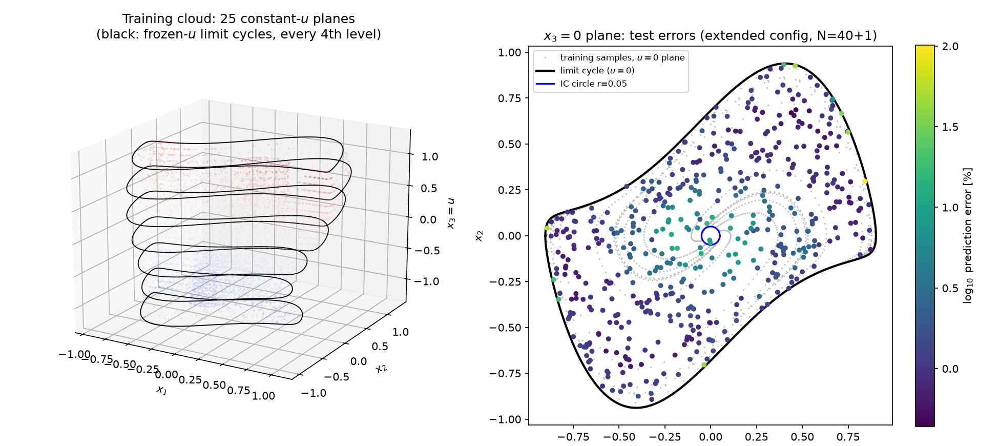
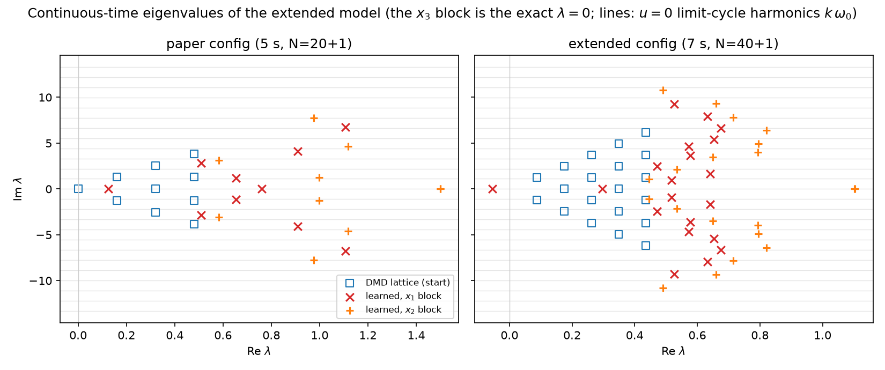
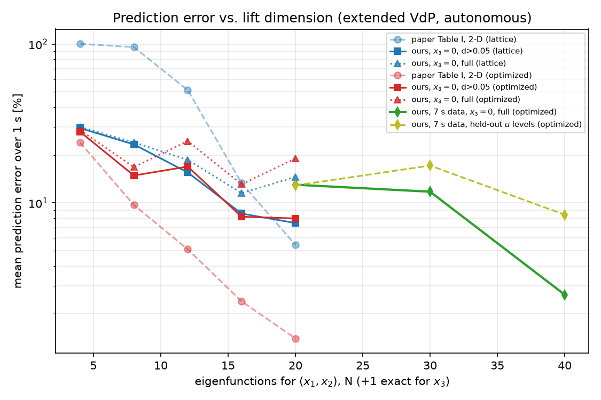
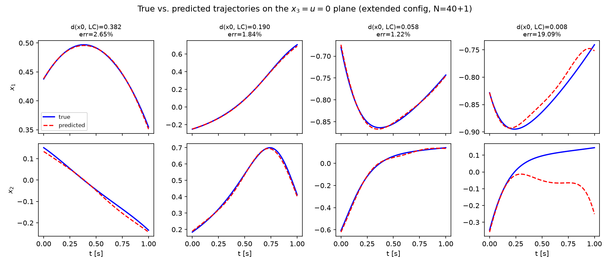
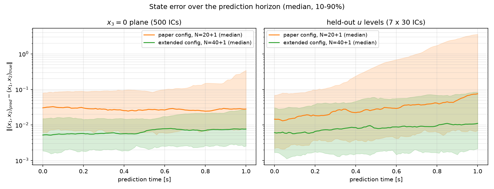
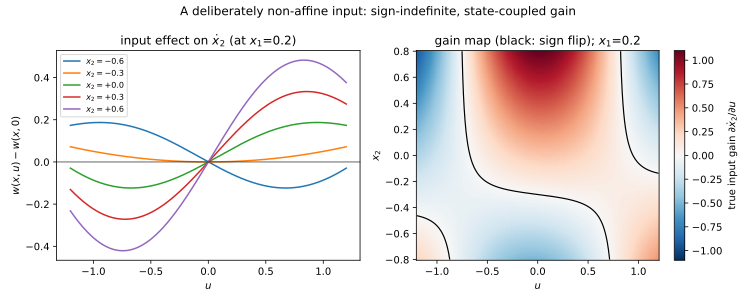
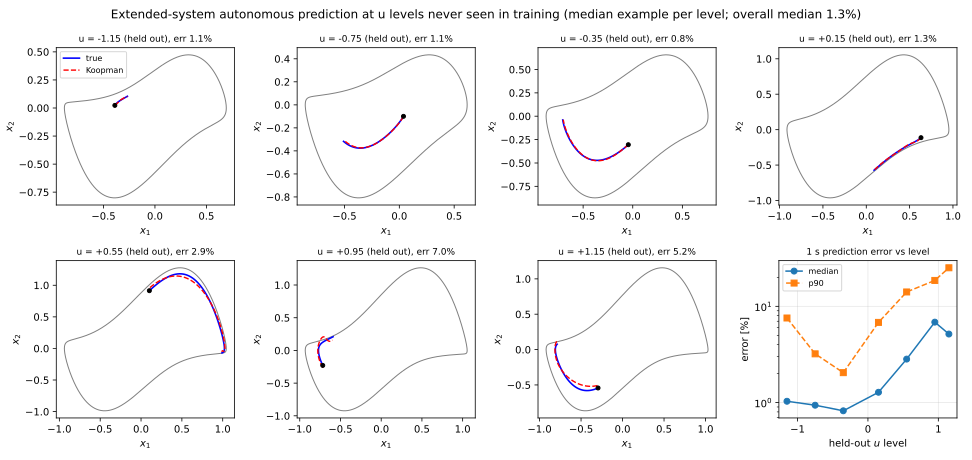
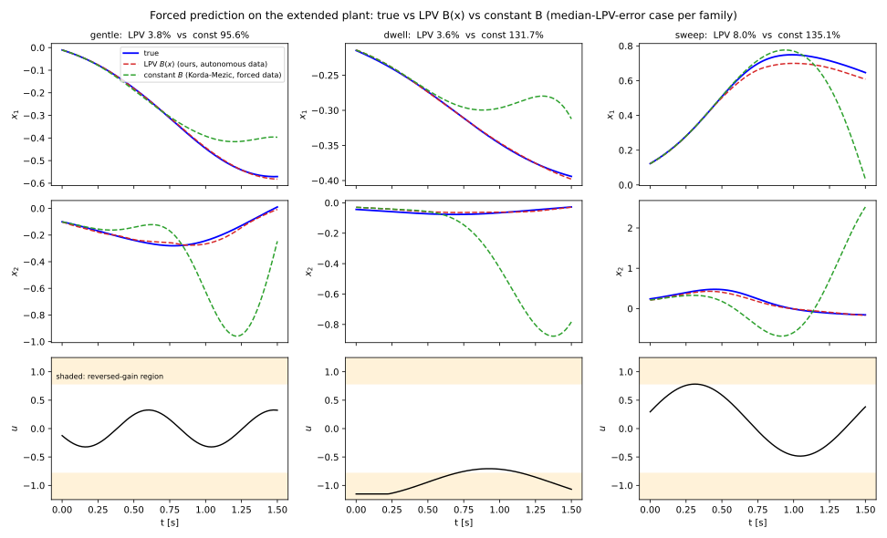
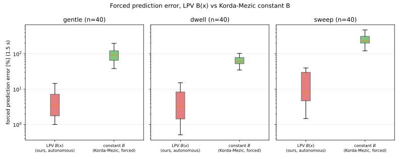

# Figure reference — every plot in `reports/figures/`, in full detail

This document makes each figure self-explanatory: what exactly it plots,
where every line and marker comes from in the code, what data and model
produced it, and how to read it. The interpretation of the *results* lives
in the three validation reports
([`validation_nonaffine.md`](validation_nonaffine.md), the core study;
[`validation_vdp.md`](validation_vdp.md);
[`validation_vdp_control.md`](validation_vdp_control.md)). This file
documents the figures themselves, so anyone can reproduce, audit, or modify
them without reverse-engineering the plotting code.

All 15 figures come from five example scripts, each writing directly into
`reports/figures/`. Every one of them works on the **same plant in its
input-extended form**, with the same cached model and, where an input
model appears, the same two input matrices:

| figures | script | what it fits/evaluates | runtime (model cached) |
|---|---|---|---|
| fig1 – fig5 | `examples/run_vdp_benchmark.py` | autonomous prediction of the extended model, Table I sweep | ~25 min |
| fig6 – fig8 | `examples/run_vdp_control_benchmark.py` | forced prediction under the Korda–Mezić test signals, implied input gain | ~6 min |
| fig9, fig10, fig15 | `examples/run_vdp_mpc.py` | closed-loop MPC, LPV B(x) vs constant B, and the actuation limits that set the tasks | ~1.5 min |
| fig11 – fig14 | `examples/run_nonaffine_benchmark.py` | the input law, held-out-level validation, three-family forced comparison | ~3 min |

Every script is deterministic given its fixed `np.random.default_rng(seed)`
calls (seeds are called out per figure below), matplotlib backend `Agg`,
`dpi=150`. Re-running a script reproduces its figures (modulo
floating-point nondeterminism in BLAS across machines).

## Building blocks referenced throughout

* **The error metric** (Korda & Mezić 2020, eq. 55), implemented in
  `metrics.relative_rmse_percent`:

  ```
  error[%] = 100 * ||x_pred - x_true||_F / ||x_true||_F
  ```

  computed over an entire predicted trajectory (all time samples) of the
  physical states (x1, x2) against the true trajectory from the same
  initial condition. x3 = u is excluded everywhere: it is either constant
  (autonomous) or integrated exactly, and including it would dilute the
  error. This is what every axis or colorbar labeled "error [%]" means.

* **The plant, always in extended form** (`nonaffine.vdp_nonaffine` +
  `nonaffine.extend_input`):

  ```
  x1' = 2 x2
  x2' = -0.8 x1 + 2 x2 - 10 x1^2 x2 + w(x1, x2, x3)
  x3' = v                 x3 := u, v := u' (the new input)
  w   = (0.15 + 0.5 x2) sin(2 x3) + 0.25 x1 x3^2
  ```

  The control field is the constant `g_ext = (0, 0, 1)`: the extended
  system is input-affine whatever w looks like. For constant u (v = 0)
  each slice x3 = u is a Van der Pol oscillator with an unstable focus at
  a u-dependent equilibrium (`nonaffine.equilibrium`) and an attracting
  limit cycle. **The slice x3 = 0 is exactly the scaled Van der Pol of
  Korda & Mezić** (w(x, 0) = 0): origin with eigenvalues `1 ± i*sqrt(0.6)`,
  limit cycle of amplitude ≈ 0.9, period ≈ 5.674 s (`ω0 = 1.1074` rad/s).

* **Limit cycles** drawn as black curves come from
  `nonaffine.level_limit_cycle(sysna, u)`: simulate the frozen-u slice for
  60 s from 0.3 away from the level's equilibrium, keep the last 20 s, and
  cut out one period between two consecutive upward zero-crossings of the
  angle around the equilibrium.

* **The shared model** (`extended_vdp.get_model`, cached in
  `reports/model_nonaffine.pkl`): training data from
  `make_extended_training_data` — 25 constant-u levels
  `linspace(-1.2, 1.2, 25)`, 12 trajectories per level starting on a
  radius-0.05 circle around that level's equilibrium, integrated 7 s at
  `Ts = 0.01` with x3 frozen. The cloud is a stack of 25 planes
  (300 trajectories, ≈ 210k samples). Fit
  (`extended_vdp.fit_extended_model`):
  `FitConfig(n_eig=[20, 20, 1], constant_components=(2,),
  alpha_bounds=(-20, 1.5), base_eigs=<DMD eigenvalues with the exact λ=0 of
  x3 removed>, boundary_rcond=1e-3)`. Written "N = 40+1": 20 eigenfunctions
  each for x1 and x2, plus x3 fitted exactly as a single λ = 0 component
  whose boundary value is the level. Lifting a new point interpolates the
  tabulated eigenfunction values over the 3-D Delaunay triangulation of
  the cloud.

* **The two input models** every comparison figure shows
  (`extended_vdp.fit_input_models`; colors fixed by `extended_vdp.LPV` /
  `extended_vdp.KM`):

  | tag | color | what it is | data it needs |
  |---|---|---|---|
  | `lpv_knn` (**ours**) | red | `fit_b_knn(model, ext.g, pts, k=20, f=ext.f, method="fd", options=fd_opts, blend=0.3)` — FD gradients of the interpolated eigenfunctions with per-dimension steps (`2e-3` in-plane, half the 0.1 level spacing across planes), sampled at 3 600 points (`b_sample_points`: 150 interior points at each of 24 levels spanning ±1.15, seed 5), smoothed by a 20-nearest-neighbour average weighted by PDE-residual reliability, with confidence blending toward the weighted-mean constant in unreliable neighbourhoods | autonomous only |
  | `km_const_forced` (baseline) | green | `fit_constant_b_forced(model, forced, Ts)` — Korda & Mezić's recipe: one constant B by least squares on the one-step lifted residual `z⁺ − Ad z = Γ B v` over 60 forced experiments (`forced_experiments`: white-noise ZOH `v ~ U(−3, 3)`, 150 steps each, v zeroed when u would leave ±1.15, seed 9); steps whose lift leaves the training hull are dropped | forced (60 experiments) |

  Ablations computed by the same function and reported **in tables only**:
  `lpv_poly3` (same samples, one global degree-3 polynomial per lifted row,
  `fit_b_field`), `const_auto` (degree-0 reduction of the same samples:
  the best constant available from autonomous data), and, in the
  non-affine benchmark, `zero_B` (B = 0 everywhere, so x3 stays at its
  initial value: the autonomous prediction at the starting level).

* **Forced rollouts** (`lpv.predict_forced`): lift the initial extended
  state, then step `z ← Ad z + Γ B v` with the exact ZOH pair. A
  state-dependent B is re-evaluated at the model's own predicted state,
  clipped into the training-data bounding box (`x_clip`), on sub-steps sized
  so x3 moves at most `max_dx = 0.05` per evaluation. The truth comes from
  `nonaffine.simulate_true`: the extended ODE with the exact plant and the
  same ZOH v, so u is piecewise linear.

---

## Part 1 — Autonomous prediction (`run_vdp_benchmark.py`, figs 1–5)

### Models and data behind all five figures

* **`data7`**: the shared model's training data (above). **`data5`**: the
  same trajectories truncated to 5 s (`extended_vdp.truncate`), the
  "paper configuration".
* **Test set (a), the x3 = 0 plane**: 500 initial conditions (150 with
  `--quick`) uniform over the interior of the u = 0 limit cycle
  (`vdp_benchmark.sample_interior`, rejection sampling inside the
  polygon), `rng = np.random.default_rng(7)`; truth = 1 s of the frozen
  u = 0 slice at `Ts = 0.01` (101 samples). `d_lc[j]` is the distance from
  IC `j` to the nearest point of the limit cycle
  (`cKDTree(lc).query(x0s)`), the "how close to the cycle" scalar used for
  coloring and the near-LC split (`d_lc < 0.05`).
* **Test set (b), held-out levels**: 30 ICs (15 with `--quick`) at each of
  u ∈ {−1.15, −0.75, −0.35, 0.15, 0.55, 0.95, 1.15} — none of them a
  training plane — sampled inside each level's limit cycle shrunk to 90 %,
  `rng = np.random.default_rng(3)`.
* **`keep["paper_N20_optimized"]`**: `fit_extended_model(data5, n_half=10)`
  — the closest match to the paper's own N = 20 configuration.
* **`keep["best"]`**: the shared N = 40+1 model, loaded from the cache
  rather than refitted.

### `fig1_phase_portrait.png`



**Left (3-D)**: every 37th training sample of `data7`, colored by x3
(`coolwarm`: blue = negative u, red = positive), with the frozen-u limit
cycles of every 4th training level drawn in black at their own height.
Shows what "the extended state" looks like as data: a stack of planes,
each holding one Van der Pol slice whose cycle shifts and deforms with u.

**Right (the x3 = 0 plane)**: the 12 u = 0 training trajectories (gray
dots, every 5th sample), the u = 0 limit cycle (black), the IC circle
r = 0.05 (blue), and the 500 test ICs colored by log₁₀ error of the
shared model. **How to read it**: errors are lowest in the band the
training spirals cover densely and rise near the cycle and close to the
origin, where 12 spirals leave angular gaps.

### `fig2_eigenvalues.png`



Continuous-time eigenvalues, two panels: the paper-config N = 20+1 model
(left) and the shared N = 40+1 model (right). Blue squares: the DMD
lattice the refinement starts from (`lattice_spectrum(base, n_half)`, with
`base` the DMD eigenvalues of that model's data). Red crosses and orange
pluses: the learned eigenvalues of the x1 and x2 blocks. The x3 block (the
exact λ = 0) is not drawn. Pale horizontal lines are the u = 0 cycle's
harmonics k·ω₀. **How to read it**: refinement moves the eigenvalues well
away from the lattice. Since one spectrum serves slices whose cycles have
different frequencies, the learned modes do not lock onto the u = 0
harmonics.

### `fig3_error_vs_N.png`



Mean 1 s error vs. N (eigenfunctions for (x1, x2); +1 for x3), log scale.
Pale dashed circles: Korda & Mezić Table I (lattice blue, optimized red),
a 2-D model fitted to the x3 = 0 system alone with 100 trajectories.
Solid squares: ours on x3 = 0 in the interior (d > 0.05); dotted
triangles: ours over the full interior; both from the 5 s sweep
N ∈ {4, 8, 12, 16, 20}. Green diamonds: the 7 s optimized models
N ∈ {20, 30, 40} over the full x3 = 0 interior. Olive diamonds: the same
models' mean error on the held-out levels (a mean, so dominated by the
u = +0.95 / +1.15 tails). Not drawn with `--quick`.

### `fig4_predictions.png`



True (blue) vs. predicted (red dashed) x1 (top) and x2 (bottom) over 1 s
for the shared model, from four x3 = 0 test ICs picked at the 85th, 50th,
15th and 2nd percentile of `d_lc` — deep interior on the left, on the
limit cycle on the right. Titles give `d_lc` and the IC's error.

### `fig5_error_vs_time.png`



The state error `‖(x1, x2)_pred(t) − (x1, x2)_true(t)‖` against
prediction time: median line and 10–90 % band, paper config (orange) vs.
shared model (green). Left: the 500 x3 = 0 ICs. Right: all 7 × 30
held-out ICs pooled. **How to read it**: for the shared model the error is
already present at t = 0 and stays flat. It is the in-sample fit residual
of one spectrum shared by 25 planes, not drift
([`validation_vdp.md`](validation_vdp.md) §3). The paper-config model's
band widens over the horizon on the held-out levels.

---

## Part 2 — Forced prediction under the Korda–Mezić test signals (`run_vdp_control_benchmark.py`, figs 6–8)

### Signals and initial conditions behind figs 6–7

`signal(kind, amp, K=100)` gives u waypoints over 1 s: **square**
`amp · sign`, 300 ms period, starting at +amp; **sine**
`amp · sin(2πt / 0.06)`, 60 ms period, starting at 0 — the paper's two
waveforms, applied to the physical input u. `u_profile_to_v` converts them
to `(u0, v)` with `v_k = (u_{k+1} − u_k)/Ts`, so u is piecewise linear
through the samples: a square-wave jump is a single 10 ms ramp, and the
sine is a ~6-sample-per-period zigzag. For each signal, 250 ICs (100 with
`--quick`) uniform over the interior of the limit cycle at the starting
level u0, `rng = np.random.default_rng(7)`. The figures use amplitude 1;
amplitude 0.5 appears in the tables only.

### `fig6_forced_predictions.png`


3×4 grid. Columns: square wave at a mid-interior IC (the one closest to
the 60th percentile of `d_lc`), square wave at the IC closest to the
cycle, then the same two for the sine. Rows 0–1: x1 and x2, with true
(blue), LPV B(x) (red dashed) and K-M constant B (green dashed). Row-0
titles give both errors. Row 2: the u(t) profile, with the
reversed-gain bands |u| > π/4 shaded orange. **How to read it**: on the
square wave the green trace drifts away within a few switches while red
stays close to the truth (less so for the near-cycle IC); on the fast sine both stay close and the constant is
slightly better, the case discussed in
[`validation_vdp_control.md`](validation_vdp_control.md) §3.

### `fig7_forced_error_map.png`


Square wave, amplitude 1: each of the 250 ICs is a dot at its (x1, x2)
position inside the u0 = +1 limit cycle (black), colored by that rollout's
error on one shared logarithmic color scale. Left: LPV B(x). Right: K-M
constant B. Titles give the medians. **How to read it**: the whole right
panel sits one to two decades above the left. The LPV errors rise toward
the cycle, the time-depth limit of the eigenfunction construction.

### `fig8_input_gain_map.png`


The input gain on ẋ2 that each model implies, on the slice x1 = 0, over a
47 × 61 grid of (u, x2) masked to points inside each level's limit cycle.
Left: the true gain `∂ẋ2/∂u = 2(0.15 + 0.5 x2) cos(2u) + 0.5 x1 u` from
`sysna.dfdu`. Middle and right: `(C A B)_2 / (C B)_3` for the LPV field
(B evaluated at each grid point) and for the K-M constant (one number
everywhere). This is the change in ẋ2 per unit change of x3 = u that the
lifted dynamics produce. Shared diverging color scale (`RdBu_r`, centered
at 0); the black contour is the true sign flip, drawn on all three panels.
Titles give each model's RMSE against the truth and the fraction of the
slice where it has the right sign. **How to read it**: the K-M panel is a
single color, so it is wrong in sign wherever the true gain is negative.
The LPV panel reproduces the red lobe above x2 = −0.3 and its decay past
|u| = π/4, with visible noise from the gradient samples.

---

## Part 3 — The non-affine benchmark (`run_nonaffine_benchmark.py`, figs 11–14)

### `fig11_input_law.svg`



**This figure uses no fitted model**: both panels evaluate the analytic
plant, establishing the stress test the rest responds to.

**Left**: for x1 = 0.2 and x2 ∈ {−0.6, −0.3, 0, 0.3, 0.6} (one line each),
`w(x, u) − w(x, 0)` vs. u over [−1.2, 1.2]. Since `w(x, 0) ≡ 0`, this is
the full input-driven contribution to x2'. The curves are non-monotonic
(they rise, peak, and bend back), and the x2 = −0.6 and +0.6 curves point
in *opposite* directions for the same u, because their multiplier
`0.15 + 0.5 x2` has opposite signs.

**Right**: heatmap of the analytic gain `∂ẋ2/∂u` over
`x2 ∈ [−0.8, 0.8] × u ∈ [−1.2, 1.2]` (x1 = 0.2, `rasterized=True` to keep
the SVG small), with the zero contour in black. The contour crosses
u = ±π/4 (the `sin(2u)` crest) and x2 = −0.3: the two sign flips of
[`validation_nonaffine.md`](validation_nonaffine.md) §2.

### `fig12_autonomous_extended.svg`



**Model**: the shared model. **Protocol**: 1 s predictions from 30 interior
ICs (shrink 0.9, `rng = np.random.default_rng(3)`) at each of the 7
held-out levels. Truth from `nonaffine.frozen(sysna, u).simulate`;
prediction `model.predict([x0_1, x0_2, u], t)[:, :2]`. For each level the
**median-error** IC (`argsort(errs)[len // 2]`) is shown — representative,
not best or worst.

**Layout**: 2×4. Panels 1–7, one per held-out level: that level's limit
cycle (gray), true trajectory (blue), Koopman prediction (red dashed),
start point (black dot); title gives the level and the example's error.
Panel 8: `semilogy` of the per-level median (circles) and p90 (squares)
error vs. the held-out u value. The suptitle gives the median of the
per-level medians (≈ 1.3 %).

**How to read it**: close blue/red overlap in panels 1–7 confirms that the
eigenfunctions interpolate *across* the u-planes. Panel 8 rises toward
positive u, where the slices are more strongly unstable and one shared
spectrum fits them with more compromise.

### `fig13_forced_comparison.svg`



**True vs. LPV B(x) vs. K-M constant B** forced trajectories, side by
side, on the plant whose input law (fig11) defeats any constant input
matrix.

**Test signals**: three families of piecewise-linear u profiles
(`make_u_profile`), each a clipped sine with randomized amplitude, offset,
period and phase:

* **gentle** — amplitude 0.2–0.4, offset ±0.1, period 0.8–2.0 s: stays in
  the monotone-gain region |u| < π/4;
* **dwell** — amplitude 0.15–0.3, offset ±(0.85–1.0): sits *past* the gain
  flip most of the time;
* **sweep** — amplitude 0.6–1.0, offset ±0.15, period 0.8–1.6 s: crosses
  the flip repeatedly.

Per family, 40 cases (15 with `--quick`; `rngt = np.random.default_rng(17)`
re-seeded at the start of each family): a u profile, an interior start on
the u0 level (shrink 0.75), a 1.5 s ground-truth rollout, and a rollout
from every input model. The case **shown** is the one with the family's
median `lpv_knn` error, chosen to be representative.

**Layout**: 3×3, columns = families. Rows 0–1: x1, x2 with true (blue),
LPV (red dashed), K-M constant (green dashed); the row-0 title gives both
errors. Row 2: u(t), with the reversed-gain bands shaded orange.

**How to read it**: red hugs blue in all three columns; green bends away
within the first second and ends far off, most visibly while u is in or
crossing the shaded band.

### `fig14_forced_error_stats.svg`



The population version of fig13: box plots of all `n_test` per-case errors
per family, for the same two models (LPV red, K-M constant green),
`showfliers=False`, log y-axis shared across the three panels. **How to
read it**: the boxes do not overlap in any family; the medians differ by
roughly 25× (gentle), 19× (dwell) and 29× (sweep). The three ablations are
in the table of [`validation_nonaffine.md`](validation_nonaffine.md) §5,
not here.

---

## Part 4 — Koopman-LPV MPC (`run_vdp_mpc.py`, figs 9, 10, 15)

### Controller setup common to figs 9–10

`KoopmanMPC(model, B, cfg, x_clip=…)` on the shared model, once with each
input model, then `run_closed_loop` against the true extended plant
(`extend_input(vdp_nonaffine())`). The MPC's input is v = u̇; with
`integrator_state=2` its decision variable is the u-sequence itself, so
the box `|u| ≤ 1.15` is exact. Control period `ts = 0.1` s, horizon 8 s
(80 steps), long enough for the focus's 4.06 s half-rotation. Weights are
shared by both arms and chosen neutrally (best combined score of a
72-configuration sweep; see
[`validation_vdp_control.md`](validation_vdp_control.md) §7).

### `fig9_mpc_stabilization.png`


Task 1: drive the state to the unstable origin from x₀ = 0.25·lc[800]
(‖x₀‖ = 0.188, inside the null-controllable region; see fig15), 20 s,
Q = (1, 0.05, 0.1), R = 1e-4, S = 1e-2.

* **Left** — phase plane: u = 0 limit cycle (black), open loop with
  u ≡ 0 (gray), closed loop with LPV B(x) (red) and with K-M constant B
  (green), x₀ (blue), target (red star). Red spirals into the origin before
  escaping; green never approaches it.
* **Middle** — ‖(x1, x2)‖ on a log axis. Red falls to ≈ 2e-2 by t = 4.4 s
  and stays below 0.1 for 3.8 s, then escapes to the limit cycle. Green
  never drops below its starting value. **The run is deliberately 20 s
  long**, so the escape is visible; how long the hold lasts is sensitive
  to roundoff-level perturbations of x₀.
* **Right** — the actuator u = x3 with its ±1.15 box (dotted). This is u,
  not the MPC's decision variable v.

### `fig10_mpc_tracking.png`


Tasks 2 (sine x1 = 0.10 sin(0.8t), 15 s; left) and 3 (setpoints ±0.10,
4 s dwell, offset-free, 32 s; right). Three rows: x1 with the reference
(black dashed), the actuator u = x3 with its box, and the MPC's input
v = u̇. **Read honestly, this figure is a negative result for the LPV
field**: on the sine the constant-B arm stays bounded (though out of
phase, RMS 0.11) while the LPV arm escapes at t ≈ 6.5 s (RMS 0.53); on the
switching setpoints both arms fail. The v row shows the rate is only
penalized, not bounded (spikes reach ±23).

### `fig15_actuation_limits.png`


Why the tasks are as small as they are. The input enters as w, worth at
most ±0.15 on ẋ2 at the origin. Each panel contrasts a larger task
(red, "too large") with the chosen one (green):

* **Left** — sine tracking: the w that exact tracking demands (line) vs.
  the w the actuator can produce at that state (band, from the w envelope
  over |u| ≤ 1.15). A = 0.3/ω = 1.2 leaves its band over 54 % of the
  period; A = 0.1/ω = 0.8 stays inside.
* **Middle** — constant setpoints: required w = 0.8r against the
  achievable band at x = (r, 0). ±0.25 sits just outside it; ±0.10 has
  margin.
* **Right** — the origin's null-controllable region (blue dots, states
  steerable to the origin under |u| ≤ 1.15), from
  `null_controllable_region`: time-reversed integration of the extremal
  bang-bang branches over a spread of switching times. It reaches
  ‖x‖ = 0.31. A start at 0.92·LC (red, ‖x‖ = 0.69) is 2.25× outside it;
  the chosen x₀ = 0.25·LC (green) is inside.

---

## Reproducing any figure from scratch

```bash
cd lpv-koopman
pip install -e .[dev]
python examples/run_nonaffine_benchmark.py     # -> fig11..fig14 (fits + caches model_nonaffine.pkl if missing)
python examples/run_vdp_benchmark.py           # -> fig1..fig5
python examples/run_vdp_control_benchmark.py   # -> fig6..fig8
python examples/run_vdp_mpc.py                 # -> fig9, fig10, fig15
```

Each script also writes its numbers as JSON next to the figures
(`results_nonaffine.json`, `results.json`, `results_control.json`,
`results_mpc.json`) — every number quoted above is read from those
files, not eyeballed off the plots.
