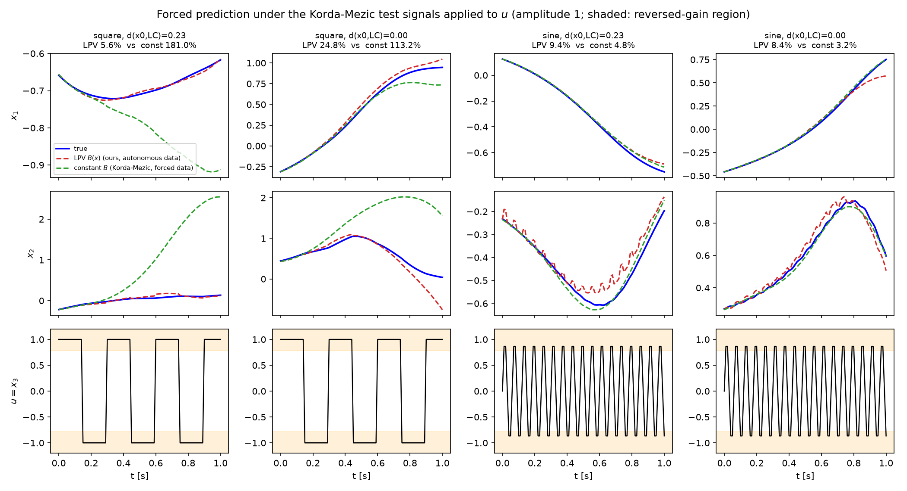
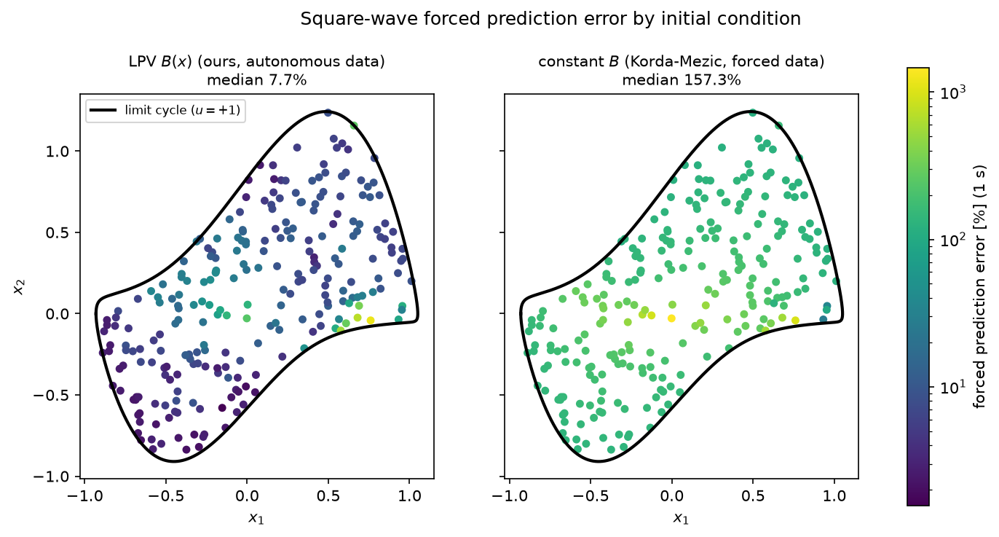
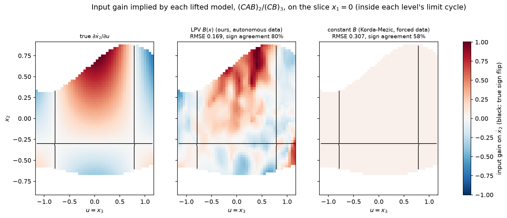
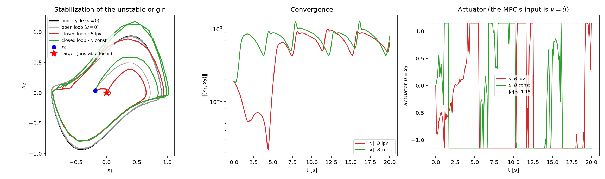
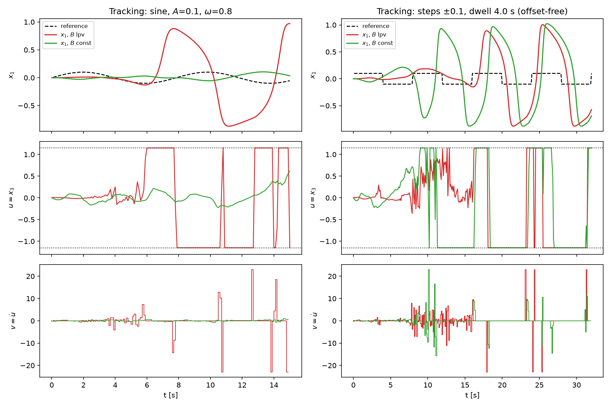
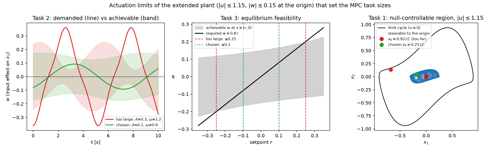

# Validation report — LPV input matrix B(x) and Koopman-LPV MPC on the input-extended Van der Pol

Every experiment here runs on the non-affine plant `vdp_nonaffine` in its
exact input-affine extension,

    ẋ1 = 2 x2,   ẋ2 = −0.8 x1 + 2 x2 − 10 x1² x2 + w(x1, x2, x3),   ẋ3 = v
    w = (0.15 + 0.5 x2) sin(2 x3) + 0.25 x1 x3²,    x3 := u,  v := u̇,

with the shared N = 40+1 model (25 u-levels × 12 trajectories, 7 s;
[`validation_vdp.md`](validation_vdp.md)) and the same two input
matrices: **LPV B(x) = ∂Φ/∂x₃**, built from autonomous data only, and the
**Korda–Mezić constant B**, regressed on 60 forced experiments. Both come
from `examples/extended_vdp.py`; every figure compares only those two.

Part 1 (§1–§4) evaluates forced prediction under the Korda & Mezić (2020)
controlled test signals. Part 2 (§5–§9) runs closed-loop MPC on the true
plant. Reproduce with `python examples/run_vdp_control_benchmark.py`
(~6 min) and `python examples/run_vdp_mpc.py` (~1.5 min); numbers land in
`reports/results_control.json` and `results_mpc.json`. The plant itself,
the extension, and the forced comparison on three dedicated input families
are in [`validation_nonaffine.md`](validation_nonaffine.md).

# Part 1 — forced prediction under the Korda–Mezić test signals

**Headline.** On the paper's square wave, the LPV field built from autonomous
data beats the forced-data constant B by a factor of 20–27 (median 7.7 % vs
157 % at unit amplitude, 3.0 % vs 81 % at amplitude 0.5). On the paper's
fast 60 ms sine the order flips: the constant B wins (5.3 % vs 11.3 %),
and the autonomous-only "no input model" control beats both. Input speed,
not only input nonlinearity, decides which model wins (§3).

## 1. Eigenfunction gradients on the extended model

B(x) needs ∂Φ/∂x; Φ is known only as tabulated values on the trajectory
cloud, a stack of 25 constant-u planes. The eigenfunction-PDE residual
‖(∂Φ/∂x)f − AΦ‖/‖AΦ‖ is the standard quality check, evaluated here at 300
points between and on the planes:

| gradient estimator | median residual | p90 |
|---|---|---|
| n-D moving least squares (k=40, quadratic) | 0.49 | 85 |
| **FD, per-dimension steps (ours: 2e-3 in-plane, 0.05 across)** | **0.18** | **0.98** |
| FD, scalar h = 1e-3 | 0.21 | 1.0 |
| FD, scalar h = 0.01 | 0.087 | 0.91 |
| FD, scalar h = 0.1 (the thesis/MATLAB default) | 0.37 | 1.7 |

Two caveats shape how to read this table:

* **The residual cannot see ∂Φ/∂x₃.** The extended field f has a zero third
  component, so (∂Φ/∂x)f only probes the in-plane derivatives. B needs
  exactly the derivative the residual ignores. The table ranks in-plane
  quality (where a coarser scalar step happens to win); B quality is judged
  by the implied input gain (§4) and by rollouts (§3).
* **MLS is blind across planes.** Its k nearest neighbours almost all share
  one u-plane, so its local quadratic is ill-posed in x₃; hence the 85 p90.
  This is why the pipeline uses FD with a cross-plane step of half the
  plane spacing (README design decision 8).

## 2. Raw pointwise B(x) vs. the smoothed field

Raw FD samples of B(x) = ∂Φ/∂x₃ have moderate magnitude (median ‖B‖ = 1.2,
max 10.6; the smoothed kNN field has median 1.1 and the K-M constant 2.1),
but they are noisy from point to point. Used directly in rollouts they give
33–112 % median error on the four test signals below, against 3–11 % for
the smoothed field. The field is therefore always smoothed before use:
`fit_b_knn` averages the k = 20 nearest raw samples with PDE-residual
reliability weights and blends toward the weighted-mean constant where the
local samples are unreliable
([`validation_nonaffine.md`](validation_nonaffine.md) §6). It is still
built from autonomous data only.

## 3. Forced prediction under the paper's test signals

Korda & Mezić's controlled benchmark drives the input with a square wave
(300 ms period) and a sine (60 ms period) over 1 s. Here the same
waveforms drive the physical input u, realized in the extended system as
piecewise-linear u through the waveform's samples (ZOH v = Δu/Tₛ). At the
paper's unit amplitude, u sits past the gain flip at |u| = π/4; at 0.5 it
stays inside the monotone-gain region. 250 initial conditions per signal,
uniform over the interior of the limit cycle at the starting level u(0);
error eq. (55) on (x₁, x₂). Median (mean) %:

| signal | **LPV B(x) (ours)** | **K-M constant B (forced)** | *abl.:* LPV poly3 | *abl.:* constant B (auton.) | *abl.:* raw pointwise B |
|---|---|---|---|---|---|
| square, A = 1 | **7.7** (27.9) | 157.3 (197.8) | 12.9 (35.5) | 6.9 (27.5) | 83.4 (112.6) |
| sine, A = 1 | 11.3 (16.7) | **5.3** (7.0) | 11.6 (13.1) | 3.5 (5.4) | 111.5 (256.0) |
| square, A = 0.5 | **3.0** (10.2) | 80.6 (103.3) | 7.5 (15.5) | 5.1 (14.7) | 33.9 (121.0) |
| sine, A = 0.5 | 3.6 (6.5) | **2.4** (4.0) | 7.0 (7.5) | 1.6 (3.1) | 40.4 (181.7) |

For orientation only, the paper's 2-D affine benchmark reports 6.0 %
(square) and 2.9 % (sine) for its forced-data constant B. That is a
different plant (input entering linearly as ẋ₂ += u), so it is not a
like-for-like comparison.

* **Square wave: LPV ≫ K-M constant**, 20× at A = 1 and 27× at A = 0.5. The
  K-M regression's failure mode is the one documented in
  [`validation_nonaffine.md`](validation_nonaffine.md) §6: the one-step
  residual absorbs autonomous model error correlated with v, and a single
  B cannot follow a gain whose sign flips. The constant reduction of our
  own field is competitive at A = 1 (6.9 %), where u spends its time on the
  ±1 plateaus and only the jumps exercise the input model.
* **Fast sine: the constant wins.** With a 60 ms period, u swings through
  its full range ~17 times in the 1 s window, far faster than the plant
  responds, so the net input effect over each period nearly cancels (the
  autonomous constant does best of all). An exact
  gradient B = ∂Φ/∂x₃ integrates to zero around a closed x₃ loop, but the
  smoothed field is not an exact gradient, so its errors accumulate over the
  ~17 sweeps of the window. The best constant has no such drift.
* **Sub-stepping is required.** With ZOH v, x₃ moves up to 2.0 within one
  10 ms step (square jumps), across 20 training planes, while the naive
  rollout freezes B(x) at the step's start. `predict_forced(...,
  max_dx=0.05)` splits each step so that x₃ moves at most half a plane
  spacing per B evaluation. In prototyping (40 ICs, A = 1) this took the
  LPV square-wave median from 71 % to 7.5 % and the sine from 161 % to
  12 %. It is an exact no-op for constant B (README design decision 14).
* Errors concentrate near the starting level's limit cycle (fig7), as in
  every other benchmark here: the time-depth limit of the eigenfunction
  construction, [`validation_vdp.md`](validation_vdp.md) §4.



*Fig. 6 — true vs. LPV vs. K-M constant under the two waveforms (A = 1),
for a mid-interior and a near-cycle initial condition each.*



*Fig. 7 — square-wave error per initial condition, both models on one log
color scale.*

## 4. The input gain each model implies

The plant's input gain is ∂ẋ₂/∂u = 2(0.15 + 0.5x₂)cos(2u) + 0.5x₁u. A
lifted model implies the gain (C A B)₂ / (C B)₃: a step in v moves x₃ by
(CB)₃ and, through the autonomous lifted dynamics, ẋ₂ by (CAB)₂. Evaluated
on the slice x₁ = 0 inside each level's limit cycle (fig8):

| input model | gain RMSE | sign agreement |
|---|---|---|
| **LPV B(x), kNN (ours)** | **0.17** | **80 %** |
| **K-M constant B (forced)** | 0.31 | 58 % |
| *ablation:* LPV poly3 | 0.084 | 85 % |
| *ablation:* constant B (autonomous) | 0.30 | 58 % |
| (zero gain, for scale) | 0.32 | — |

Both constants imply one number everywhere: they get the sign right only
where the true gain happens to share it (58 % of the slice), and their
RMSE is barely below that of predicting zero gain. The LPV field recovers
the gain's structure, including the sign flip at x₂ = −0.3 and the
reversal past |u| = π/4. The global polynomial is the better *gain*
estimator on this slice, but the worse rollout model (§3; and
[`validation_nonaffine.md`](validation_nonaffine.md) §5), because rollouts
also depend on the lifted coordinates that never enter (CAB)₂.



---

# Part 2 — Koopman-LPV MPC on the extended plant (LPV B(x) vs constant B)

Three closed-loop tasks on the true plant, run through its exact extension
(x₃ = u, v = u̇) with the *same* lifted dynamics driven by the two
competing input models: the LPV field B(x) from autonomous data, and the
Korda–Mezić constant B fitted to 60 forced experiments. Reproduce with
`python examples/run_vdp_mpc.py`; figures fig9, fig10 and fig15, numbers in
`results_mpc.json`.

Controller: lift the measured extended state, freeze B(x_k) over the
horizon (exact ZOH discretization, closed-form blockwise
Γ = A⁻¹(e^{ATs}−I)), solve the condensed tracking problem as a
box-constrained least-squares problem (`scipy.optimize.lsq_linear`, so no
extra QP dependency), apply the first move, and repeat.

## 5. Overview

**Headline, in two halves.** On *stabilization* the separation is large and
one-sided, but it is **transient, not asymptotic**: the LPV field pulls the
state to ‖x‖ ≈ 2e-2 and holds it near the origin for several seconds before
losing it, while the constant B never gets closer to the origin than its own
initial condition and failed in all 432 of its closed-loop runs, under every
one of 72 weight configurations. On *off-origin reference tracking* the LPV
field does not win at all — the constant's own optimum is better on the sine
task, and both arms fail on switching setpoints. The advantage this route
buys is real but considerably narrower than the forced-prediction study
alone would suggest (§7).

Getting to a comparison that measures model quality rather than actuator
saturation required three corrections to the original setup, each of which
is a finding in its own right (§6), and the residual tracking error is then
model error rather than a plant limit (§8).







## 6. Three corrections to the MPC setup

### 6.1 The controller was boxing the wrong variable

For the extended plant the MPC's decision variable is v = u̇; the physical
actuator command is the extra **state** x₃ = u. The original setup left
`MPCConfig`'s `u_min/u_max` at their ∓1 defaults, which therefore imposed a
*slew limit* of |u̇| ≤ 1 s⁻¹ — the loop could move u by only 0.01 per
step — while leaving u itself entirely unconstrained. The symptom is
unmissable in hindsight: every run in the old `results_mpc.json` reports
`u_max = 1.0000` exactly, i.e. the controller sat pinned on that bound for
its whole duration, and meanwhile u wandered outside the identified range
x₃ ∈ [−1.2, 1.2], where `KoopmanEigenModel.lift` silently degrades to
nearest-neighbour values and every prediction downstream is meaningless.
(`predict_forced` already guards this with `x_clip`; `KoopmanMPC` did not.)

The fix is a change of decision variable rather than a re-tuning.
Since x₃ integrates the input exactly, v_k = (u_{k+1} − u_k)/ts, the map
from the actuator sequence to the rate sequence is linear and bidiagonal.
Substituting it keeps the problem a *box-constrained* least-squares one —
so `lsq_linear` still applies, no QP dependency is added — but the box now
constrains u itself:

```
decision variable  w = [u_1 … u_Np],   bounds [−U_MAX, U_MAX]
v = (D w − e₀u₀)/ts    (D = I − shift)
```

Implemented as `MPCConfig.integrator_state`; it is opt-in, so an MPC whose
decision variable is the actuator itself is unchanged. Verified to reproduce the direct solve to 1e-13
when the box is inactive, confirming the substitution is exact and not an
approximation. `KoopmanMPC` also gained the `x_clip` guard that
`predict_forced` already had.

### 6.2 The horizon was five times too short

With the input bounded correctly the loop still failed. The reason is
geometric: the origin is an unstable **focus** with eigenvalues 1 ± 0.775i,
and the extremal controls that trace the boundary of its null-controllable
region switch on the half-rotation period π/β = **4.06 s**. A horizon of
0.8 s cannot represent the manoeuvre that stabilization requires. Horizon
length, not weighting, was the binding constraint:

| control rate ts | horizon | LPV ∫‖x‖dt | settled ‖x‖ |
|---|---|---|---|
| 0.01 | 0.8 s | 4.25 | 0.66 |
| 0.05 | 8 s | 4.21 | 0.76 |
| 0.10 | 4 s | 4.61 | 0.88 |
| **0.10** | **8 s** | **1.11** | **0.163** |
| 0.15 | 8 s | 1.70 | 0.41 |
| 0.10 | 12 s | 5.58 | 0.75 |

Two things worth noting. The horizon must be bought by coarsening the
control rate — at ts = 0.01 an 8 s horizon is an 800-step condensed QP per
solve, which is not real-time — and 12 s is *worse* than 8 s, because model
error accumulates over the prediction faster than the extra foresight is
worth. The chosen operating point is ts = 0.10 s, Np = 80.

### 6.3 Task sizes are set by the plant's actuation limits

The input enters as

```
w(x,u) = (0.15 + 0.5 x₂) sin(2u) + 0.25 x₁ u²,     |u| ≤ 1.15
```

which at the origin is worth `0.15 sin(2u)`: **±0.15 of authority on ẋ₂**,
against an unstable focus with Re λ = 1. Tasks sized like the usual Van der
Pol MPC demos (stabilize from 92 % of the limit-cycle radius, track a 0.3
sine, hold ±0.25 setpoints) are all beyond this plant's reach, which fig15
quantifies:

| task | larger version | demanded | achievable | verdict |
|---|---|---|---|---|
| 1. stabilize from 0.92·lc | ‖x₀‖ = 0.692 | — | null-controllable reach **0.313** | **2.25× outside**; unreachable |
| 2. sine A=0.3, ω=1.2 | — | ‖w‖ up to **0.360** | ≤ 0.253, and only ±0.06 at the worst instant | infeasible over **54 %** of the period |
| 3. setpoints ±0.25 | — | w = **0.2000** | **0.1989** | infeasible by 0.0011 |

The null-controllable region (the set of states steerable to the origin) is
computed by reversing time and integrating the extremal bang-bang branches
outward over a spread of switching times — for a planar single-input system
that traces its boundary exactly. It reaches 0.313 in ‖x‖; a start at
0.92·lc sits at 0.692. This is confirmed independently by an *oracle*
controller — a receding-horizon MPC given the true plant, a 3 s horizon and
full knowledge — which pulls ‖x‖ to 0.28 by 2 s and then loses it back to
0.78 by 6 s. **No controller can perform the larger task 1**, so bang-bang
saturation on those tasks would be the controller correctly failing at an
impossible demand, not a tuning defect.

#### The sharper limit: recoverable margin collapses at off-origin setpoints

Pointwise feasibility of the equilibrium input is necessary but *not*
sufficient. Holding a setpoint at +r already spends most of the push-up
authority, so the region from which that setpoint can still be recovered
shrinks asymmetrically — computed around each (r, 0) at its equilibrium u*:

| r | u* | w margin | reach −x₁ | **reach +x₁** |
|---|---|---|---|---|
| 0.00 | 0.000 | 0.150 | 0.313 | **0.248** |
| 0.10 | 0.274 | 0.087 | 0.413 | **0.148** |
| 0.15 | 0.427 | 0.057 | 0.463 | **0.098** |
| 0.20 | 0.613 | 0.027 | 0.513 | **0.048** |
| 0.25 | — | −0.001 | 0.563 | **0.000** |

At r = 0.20 any overshoot beyond 0.048 is unrecoverable — and an MPC
carrying 10–40 % forced-prediction error *will* overshoot that. This is why
the setpoint amplitude is 0.10 rather than the pointwise-feasible 0.20, and
it is a genuine limitation of the input-extension approach on a plant whose
gain is this weak, not an artifact of the Koopman model.

Chosen tasks: x₀ = 0.25·lc (‖x₀‖ = 0.19), sine A = 0.10 / ω = 0.8,
setpoints ±0.10 with a 4 s dwell.

## 7. Weight selection under a bistable closed loop

The tuned closed loop is **bistable**: it either holds the reference or
escapes to the limit cycle, with essentially nothing in between. Adjacent
weight settings give RMS 0.169 and 0.44; the error distribution is bimodal,
not unimodal-with-noise. Taking the argmin of a single run would therefore
be fitting the noise, and would report a controller that works by luck.

Weights are instead selected by **robustness**: for each task, 72 (Q, R, S)
configurations are run from 6 perturbed initial conditions per input model
(864 closed-loop runs per task), ranked first by how many of the 6 stayed
bounded and only then by median error.

Crucially the shared weights are picked by a **neutral** criterion — best
combined LPV + constant score — not by the LPV arm. Selecting on the LPV arm
and reporting whatever the constant happens to score at those weights would
rig the ablation, and on the sine task that is not hypothetical: the
constant's own optimum holds 4/6 where it holds 0/6 at the LPV optimum.
Both the shared-weight result and each arm's own optimum are given below.

| task | shared Q / R / S | LPV @ shared | const @ shared | LPV own best | const own best |
|---|---|---|---|---|---|
| 1. stabilization | (1, 0.05, 0.1) / 1e-4 / 1e-2 | **2/6**, med 0.840 | **0/6**, med 0.930 | 2/6, med 0.840 | 0/6, med 0.885 |
| 2. sine A=0.10 | (1, 0.2, 0.5) / 1e-2 / 1e-3 | 1/6, med 0.497 | **4/6**, med 0.102 | 3/6, med 0.169 | **4/6, med 0.102** |
| 3. steps ±0.10 | (1, 0.2, 0.5) / 1e-2 / 1e-3 | 0/6, med 0.664 | 1/6, med 0.650 | 1/6, med 0.667 | 1/6, med 0.650 |

The q₃ entry weights the actuator channel x₃ = u. Under `integrator_state`
the box already keeps u legal, so q₃ is a control-effort term — the
analogue of a classical R‖u‖² effort penalty, since R here weighs u̇
instead. Larger q₃ and R both help by keeping the loop gentle and the
state inside the region where the model is trustworthy.

### What the three tasks actually show

The results are **task-dependent, and only task 1 is a clean LPV win.**
Aggregated over all 72 configurations × 6 ICs = 432 runs per arm per task:

| task | LPV runs held | const runs held | configs where const held ≥ once |
|---|---|---|---|
| 1. stabilization | **27 / 432** | **0 / 432** | **0 / 72** |
| 2. sine | 40 / 432 | 10 / 432 | 4 / 72 |
| 3. steps | 1 / 432 | 1 / 432 | 1 / 72 |

* **Task 1 — a large but *transient* LPV win.** Scored over 20 s the
  separation is unambiguous, but it is not asymptotic stabilization:

  | arm | min ‖x‖ reached | at t | dwell ‖x‖<0.1 | ‖x‖ at 20 s |
  |---|---|---|---|---|
  | LPV B(x) | **2.2e-2** (from ‖x₀‖ = 0.188, a 9× reduction) | 4.4 s | **3.8 s** (t = 1.1 → 4.8 s) | 0.65 |
  | constant B | **1.84e-1** — its own starting value | 0.2 s | **never** | 0.79 |

  The LPV field pulls the state to within 0.1 of the origin within about
  1 s, holds it there for **3.8 s** (reaching 2.2e-2 at t = 4.4 s), and
  then loses it around t = 5 s.

  *How long* the hold lasts is not a stable number. The closed loop is
  deterministic, but perturbing x₀ by 1e-12 moves the hold interval to
  4.7 s, by 1e-9 to 4.1 s. An earlier run of the same script, on the same
  model and the same two input matrices, held for 8.7 s and reached
  1.4e-2. Today's script reproduces bit-for-bit across processes, so the
  cause of that earlier divergence was not traced, but it is well within
  the spread that 1e-12 perturbations produce. The robust statistic is the
  count over the weight sweep below, not any single run's escape time. The constant B **never gets closer to the
  origin than its own initial condition** — it never reaches ‖x‖ < 0.15 at
  any time, and it failed in every one of its 432 runs under every
  weighting tried. So the claim supported by the data is "the LPV field
  reaches and transiently holds the origin, and the constant never
  approaches it at all", not "the LPV field stabilizes the plant".

  The escape has a consistent explanation. Relative forced-prediction
  error stays at 15–40 % as ‖x‖ → 0 (§8), so once the state is small
  enough the feedback is acting largely on model error while the unstable
  focus keeps its Re λ = 1 growth — the loop cannot win that race
  indefinitely. Mechanism for the *advantage*: the task holds u near 0 and
  the state near the origin, exactly where the constant's error is worst
  and where the LPV field is best resolved.

  **Methodological note.** An earlier version of this scoring used the mean
  of ‖x‖ over the last 40 % of an 8 s run and reported 5/6 successes. That
  metric was wrong twice over: 8 s ends before some escapes occur, and
  averaging across an escape lets a run that finishes on the limit cycle
  score as converged. The numbers above use the *maximum* over the final
  20 % of a 20 s run, which cannot be gamed that way.
* **Task 2 — no LPV advantage; the constant's best is better.** The LPV
  arm holds more often across the sweep (40 vs 10 runs), but at its own
  optimum the constant is both more reliable (4/6 vs 3/6) and more
  accurate (median 0.102 vs 0.169). Neither arm is dependable. This is
  consistent with the caveat already recorded in `validation_nonaffine.md`
  — the LPV advantage is a transient/interior phenomenon, and a reference
  that keeps the state cycling through the region where the eigenfunction
  gradients are unreliable erodes it.
* **Task 3 — both arms fail.** 71 of 72 configurations held zero times for
  each arm. This is not a tuning failure: §6.3 shows the recoverable
  margin above a setpoint collapses to 0.148 at r = 0.10, and the models
  carry 10–40 % (LPV) to 100–500 % (constant) forced-prediction error in
  that region, so overshoot past the recoverable boundary is essentially
  guaranteed. Switching setpoint regulation on this plant is beyond what
  either input model currently supports; reducing the amplitude to ±0.05
  did not rescue it either.

The honest summary is that the input-extension + LPV-B route buys a real
and large advantage for **stabilization**, and does not currently buy one
for **off-origin reference tracking** on this plant.

## 8. The residual tracking error is model error, not plant limitation

It would be easy to attribute the remaining tracking error to the plant's
weak actuator. It is not that. An oracle controller that knows the true
plant tracks the A = 0.10 sine at **RMS 0.0012 (1.2 % of amplitude)**,
using only u ∈ [−0.30, +0.68] of the ±1.15 available — the task has ample
margin. The best Koopman-MPC result anywhere in the sweep is RMS 0.062 —
**~50× worse than achievable** — and the shared-weight runs that fig10
reports are worse still (0.111 constant, 0.534 LPV: the constant arm
stays bounded but is out of phase with the reference, the LPV arm escapes
to the limit cycle at t ≈ 6.5 s).

The gap is the lifted model's forced-prediction accuracy in the region
these tasks occupy. Measured over 0.8 s rollouts near the origin:

| initial ‖x‖ | LPV B(x) | constant B |
|---|---|---|
| 0.38 | 9–38 % | 72–174 % |
| 0.19 | 15–24 % | 108–296 % |
| 0.09 | 17–40 % | 159–**519 %** |

The autonomous model is not the problem (0.9–9.5 % over the same horizons);
the input channel is. Note also that the constant-B error *grows* as the
state approaches the origin, which is exactly where all three tasks live —
a single averaged B cannot represent a gain field whose magnitude and sign
both vary, and the mismatch is worst where the gain is smallest.

This bounds what weight tuning can achieve: the controller is limited by
B-model fidelity near the origin, so the next improvement must come from
the input model (denser autonomous sampling near the equilibrium, or a
gradient estimator that stays accurate where Φ's features are smallest) —
not from the MPC.

## 9. Bugs fixed in `run_vdp_mpc.py`

The first version of the MPC script also carried a set of defects that made
the stabilization figure unreadable independently of control quality; recorded here because
several produced *plausible-looking* output:

* both `semilogy` calls plotted the same `nx` array, so the LPV curve was
  hidden underneath the constant-B one — the figure showed one run drawn
  twice;
* `lc_lpv` leaked from the B-fitting loop, so the "limit cycle" drawn and
  the x₀ placed on it belonged to the u = +1.15 level, not u = 0;
* `ax.plot(*x0, "bo")` with a 3-vector — matplotlib parses the third
  positional as data, producing the two spurious `$x_0$` legend entries;
* the results dict used the key `"stabilization LPV nonaffine"` twice, so
  the constant-B entry silently overwrote the LPV one;
* ‖x‖ was taken over all three states, mixing the actuator into the state
  norm;
* the tracking figure labelled `res.U` as "u" — that is v = u̇; the
  actuator is `res.X[:, 2]`, now plotted on its own row;
* `get_model_na` was a verbatim copy of `run_nonaffine_benchmark.get_model`
  referencing five names this module never imported — a guaranteed
  `NameError` on any cache miss. The model and both input matrices now come
  from the shared `examples/extended_vdp.py`.
